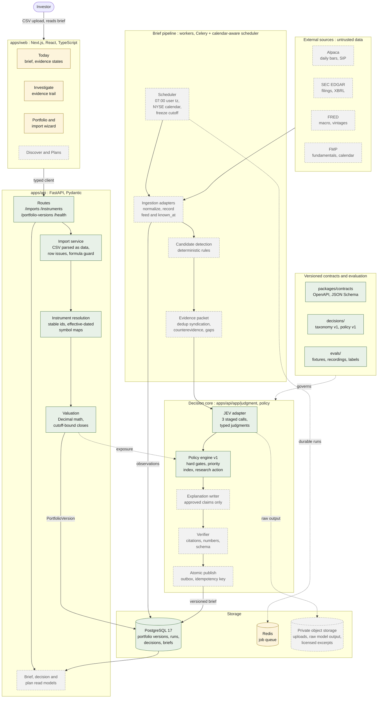
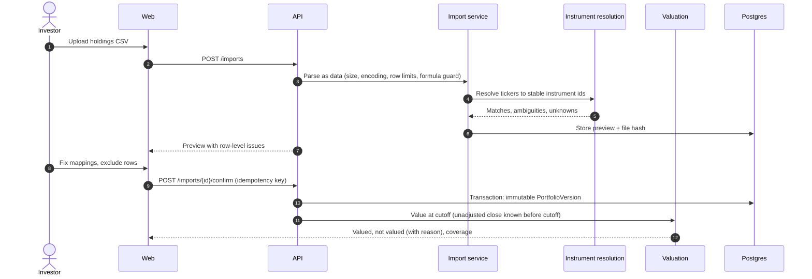
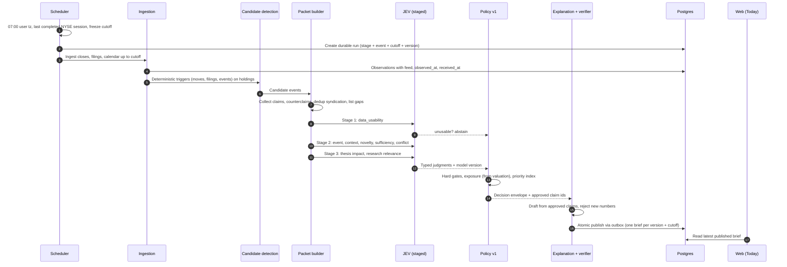

# Market Sentinel

Evidence-first equity research for active US investors. Market Sentinel tells you what changed in your
portfolio overnight, why it may matter, what is still unknown, and what would change the assessment.
It produces research and paper decisions only. It never places orders.

> Status: Phase 2 of 5, single-user pilot, running on synthetic fixtures. See [Status](#status).

## Contents

- [Problem](#problem)
- [Users](#users)
- [Solution](#solution)
- [Scope and non-goals](#scope-and-non-goals)
- [Solution design](#solution-design)
- [Architecture](#architecture)
- [Data flow](#data-flow)
- [Data model and invariants](#data-model-and-invariants)
- [Failure handling](#failure-handling)
- [Security and data rights](#security-and-data-rights)
- [Cost](#cost)
- [Measuring success](#measuring-success)
- [Status](#status)
- [Risks and open questions](#risks-and-open-questions)
- [Repository layout](#repository-layout)
- [Setup](#setup)
- [Checks](#checks)
- [Working on this repo](#working-on-this-repo)

## Problem

An active individual investor with 10 to 30 holdings has more inputs than ever: prices, headlines,
filings, screeners, charts, social feeds. What they lack is time to connect those inputs to their own
positions before the market opens.

The current morning routine looks like this:

1. Open a broker app, a news site, a charting tool and a filings search in separate tabs.
2. Scan headlines for tickers they own, often missing the one that matters.
3. Guess whether a 6% drop is company news, a sector move, or a data error after a split.
4. Read ten syndicated articles that turn out to be one press release.
5. Decide under time pressure, with no record of why.

Existing tools fail this user in three specific ways:

| Gap | What happens today | Consequence |
|---|---|---|
| Not portfolio-aware | Alerts fire on watchlist tickers with no sense of position size or thesis | Alert fatigue; important changes get ignored |
| Not evidence-aware | Headlines and AI summaries state causes without sources or counterevidence | Confident narratives built on one source or on price alone |
| Not honest about gaps | Missing data shows as zero, stale prices look current, a failed feed looks like a quiet day | Decisions made on data the user believes is complete |

Generic chat assistants make the third problem worse. Asked to "act like an expert trader", a
language model produces fluent conclusions whether or not the evidence supports them, and does
arithmetic it should not be trusted with.

## Users

**Primary: the active self-directed investor.**
Holds 10 to 30 US equities, watches another 20 to 50, trades on swing (days to two weeks) and
multiweek (two to eight weeks) horizons. Reads filings when it matters. Has 15 to 30 minutes before
the open, not two hours. Does not want trade signals; wants to know where to look first and how much
to trust what they see.

| Job to be done | Trigger | What good looks like |
|---|---|---|
| Morning portfolio analysis | Every trading day, before the open | The top issues across my holdings in about 5 minutes, each with evidence and what is unresolved |
| Discovering stocks | A theme or gap in the portfolio | A short, explainable list with why each matched, a counterargument and the exposure it adds |
| Preparing for a volatile day | Earnings, CPI, FOMC, guidance cuts | Exposed holdings, a timeline, and my own written conditions to act, reduce or wait |

**Secondary: the reviewer.** Anyone checking the system's work, including the user a week later.
They need every claim traceable to a dated source and every decision tied to the policy and model
versions that produced it.

**Explicitly not served:** day traders needing tick data, options traders, people who want the
product to pick stocks for them, and anyone expecting automated execution.

## Solution

Market Sentinel organizes inputs around the investor's **next decision**, not around a feed.

Each morning it freezes a cutoff, values the confirmed portfolio, detects candidate issues with
deterministic rules, gathers supporting and conflicting evidence, asks a judgment model narrow
versioned questions, and lets deterministic policy decide what to show. The brief contains at most
three issues. Each issue states:

- **What changed**: the observation, with source and timestamp.
- **Why it may matter**: exposure computed by code, not by a model.
- **What remains unknown**: open questions and coverage gaps, named.
- **What would change the assessment**: the evidence that would move it.
- **A research action**: `investigate_now`, `review_today`, `watch_condition`,
  `no_new_material_issue`, or `insufficient_evidence`. Never buy or sell.

Example of the intended voice:

> ExampleCo lowered its revenue outlook. Your position is 8% of the imported portfolio. The company
> release supports the guidance change; the effect on next year's margins is unresolved.
> *Source: company release, published 07:02 ET, retrieved 07:04 ET.*

Never: "AI is 92% sure you should sell."

### What makes it different

| Typical tool | Market Sentinel |
|---|---|
| Ranks by popularity or price move | Ranks by a versioned priority index over exposure, materiality, time sensitivity and relevance |
| Missing data shown as 0 or hidden | Missing data shown as unavailable, with the reason |
| A failed feed looks like a quiet day | `partial`, `stale` and `failed` are distinct visible states; a quiet day says "within current coverage" |
| One confidence number per stock | States (Supported, Mixed, Insufficient) first; numbers only after calibration is validated |
| Model writes the conclusion | Model answers bounded questions; policy code decides; explanation cites approved claims only |
| Ten articles count as ten sources | Syndication collapsed to independent originators |

The long-term moat is not model access. It is the decision taxonomy, the point-in-time evidence
archive, the labeled evaluation corpus and the longitudinal thesis history.

## Scope and non-goals

**In scope for the pilot** ([ADR-002](docs/decisions/ADR-002-scope-and-schedule.md))
- US-listed common stocks and ADRs with last close of at least $5 and 20-session average daily
  dollar volume of at least $10M, plus SPY, QQQ, IWM, DIA and the eleven Select Sector SPDRs.
- Swing and multiweek horizons. End-of-day data only.
- USD only. Non-USD positions are listed but not valued, with reason `currency_out_of_scope`.
- CSV holdings import with explicit review and confirmation.
- Brief at 07:00 in the user's timezone, covering the latest completed US regular session.

**Non-goals**
- Live or automated order execution.
- Leverage, options recommendations, auto-rebalancing.
- Model-supplied price targets or entry levels. Prices come from dated calculations or the user.
- Leaderboards, streaks, "hot picks", countdowns or any design that rewards trading frequency.
- Monetization tied to trade volume, brokerage referrals or promoted stocks.

## Solution design

### Principles

1. **Each part does only what it is reliable at.** Code does arithmetic. Retrieval finds evidence.
   A judgment model answers narrow questions. Policy code combines answers. The user decides.
2. **Missing is not zero.** A missing price, cost basis or source stays unknown and is shown as such.
3. **Abstaining is a feature.** The strongest moment in the product is declining an unsupported
   conclusion.
4. **Point in time.** Every input to a decision must have been known at the decision cutoff.
   `observed_at`, `published_at` and `known_at` are stored separately.
5. **Nothing changes silently.** Confirmed portfolios and published briefs are immutable.
   Corrections create a new revision with a reason.
6. **Untrusted text stays data.** Filings, news and uploaded files cannot change tools, policy or
   secrets, no matter what they say.

### Division of responsibility

| Responsibility | Owner | Never done by |
|---|---|---|
| Returns, weights, concentration, freshness, time alignment | Deterministic Python | Any model |
| Finding evidence and source lineage | Retrieval and provider adapters | Model memory |
| Bounded judgments (event type, novelty, evidence sufficiency, relevance) | JEV judgment model | Free-form generation |
| Integrity gates, priorities, research actions, abstention | Versioned policy code | The judgment model |
| Short explanation from approved claims | Generative model, then verifier | Free text with new numbers |
| The actual decision | The user | The system |

### Staged judgment

The judgment layer uses [TypeSafe JEV](https://docs.typesafe.ai/introduction), which returns typed
Choice, Score and Null outputs instead of prose. Questions in one call are judged independently, so
dependent questions run in stages with validated results passed forward:

| Stage | Decisions ([taxonomy v1](decisions/taxonomy/v1.yaml)) | Gate before next stage |
|---|---|---|
| 1. Integrity | `data_usability` (usable, partial, unusable) | Unusable stops here and abstains |
| 2. Classification | `event_family`, `primary_context`, `novelty`, `evidence_sufficiency` | Insufficient evidence routes to `insufficient_evidence` |
| 3. Relevance | `thesis_impact`, `research_relevance` (ordinal 1 to 5), `interpretation_conflict` | No recorded thesis abstains on `thesis_impact` |

[Policy v1](decisions/policies/v1.yaml) then applies hard gates (unusable input, stale feed,
insufficient evidence), computes the priority index with explicit weights, and selects the research
action. The model cannot waive a hard gate or promote an unusable event. A classifier output is never
treated as the probability a trade makes money.

### Expert behaviors encoded as tests, not prompts

A prompt that says "act like a seasoned trader" does not count. Each behavior below exists as a
fixture packet in [evals/fixtures/packets](evals/fixtures/packets) with expected outcomes:

| Packet | Behavior |
|---|---|
| 01 earnings, no expectations | A miss without comparable consensus is not an automatic negative surprise |
| 02 split normalization | A large fall right after a split may be a data error |
| 03 syndicated single source | Ten articles may be one source |
| 04 catalyst, uncertain response | A real catalyst can coexist with an unclear price response |
| 05 stale feed | High-confidence output is suppressed when its input is stale |
| 06 contradictory sources | Conflicting supported explanations are surfaced, not averaged |
| 07 injection in evidence | Instructions inside source text are ignored |
| 08 lookahead | Information after the cutoff is excluded |
| 09 correction | A superseded original is excluded from judgment; the audit copy is kept |
| 10 failed coverage | A failed source produces a partial state, not reassurance |

### Experience design

- Four destinations: **Today, Portfolio, Discover, Plans**. Stock detail opens the same way from all.
- Every surface uses one state model: `ready | running | partial | stale | failed | no_material_change`.
  Empty coverage is not the same as no material change.
- Progressive disclosure: concise by default, one click to excerpts, calculations, versions and
  contrary evidence.
- Calm visual language: off-white canvas, one muted accent, warning color only with text and icon,
  tabular numerals. No flashing prices, no urgency.
- Verbs are research verbs: Investigate, Compare evidence, Save plan, Review exposure, Record decision.
- Accessibility: keyboard navigation, visible focus, labeled controls, charts with text summaries.

## Architecture

A modular monolith: one repository, separate processes for web, API and workers, shared typed
contracts. Microservices wait until evidence justifies them.



Legend: green is built and tested, amber is built against fixtures or partly wired, gray dashed is
specified but not built yet.

### Stack

| Layer | Choice | Why |
|---|---|---|
| Web | Next.js, React, TypeScript, Tailwind | Typed UI, server rendering, owned design tokens |
| API | FastAPI, Pydantic | Validation at the trust boundary, OpenAPI contracts for free |
| Analytics | Python, `Decimal`, NumPy / pandas where needed | Exact money math; no floats for currency |
| Storage | PostgreSQL 17, SQLAlchemy Core, Alembic | Source of truth, transactions, tenant isolation |
| Jobs | Celery + Redis | Retryable work; durable run state lives in Postgres, not the queue |
| Files | S3-compatible private storage | Uploads, raw model output, licensed excerpts |
| Judgment | TypeSafe JEV behind an adapter | Typed bounded outputs; replaceable; model version recorded |
| Tests | pytest, Vitest, Playwright | Logic, UI and end-to-end, all deterministic |
| Ops | Docker Compose, GitHub Actions, structured logs | Reproducible local setup and CI |

### Runtime components

Each "agent" is a bounded component with typed input and output, a request budget, a timeout and a
stop condition.

| Component | Does | Must not |
|---|---|---|
| Catalyst researcher | Primary event evidence and chronology | Invent a cause from a price move |
| Market-context researcher | Benchmarks, peers, regime | Treat correlation as proof |
| Fundamentals researcher | Normalize reported values and expectations | Mix fiscal periods or currencies |
| Counterevidence researcher | Seek evidence against the hypothesis | Manufacture symmetric arguments |
| JEV classifier | Answer versioned bounded questions | Do portfolio arithmetic |
| Policy engine | Integrity gates and priorities | Let narrative override a hard gate |
| Explanation writer | Summarize approved facts | Add claims or price targets |
| Verifier | Check references, numbers, schema, coverage | Assume another model is ground truth |

### Key engineering decisions

| Decision | Alternative rejected | Reason |
|---|---|---|
| Modular monolith | Microservices | One developer, one pilot user; process separation is enough |
| Typed judgment model for classification | One large generative prompt | Typed outputs are testable, cheap, and cannot smuggle conclusions in prose |
| Staged calls with validated handoff | All questions in one call | Dependent decisions need validated upstream results |
| Policy thresholds in YAML, separate from taxonomy | Thresholds inside prompts | Changing a routing threshold must never silently change a label definition |
| Record live model calls once, replay in tests | Call models in CI | Deterministic tests, zero test spend, reproducible evals |
| Published, versioned read models | UI composes live queries | The UI shows exactly what was verified and published |
| No vector search | Embeddings from day one | No retrieval need proven yet; added only if analogue search requires it |

## Data flow

### 1. Import and valuation (built)



Missing cost basis stays unknown. Non-USD positions are listed but excluded from totals. A repeated
confirm with the same key returns the same version.

### 2. Morning brief (judgment and policy built; scheduling and ingestion planned)



### 3. Outcome review (planned)

A separate pipeline evaluates archived decisions after their horizon matures. It never mutates the
as-of packet. Decision quality and market outcome are reviewed separately.

### Decision envelope

Every published judgment carries its full lineage:

```json
{
  "schema_version": "1.0",
  "decision_id": "uuid",
  "event_id": "uuid",
  "as_of": "2026-09-25T12:00:00Z",
  "horizon": "swing",
  "packet_hash": "sha256:...",
  "evidence_ids": ["ev-1", "ev-2"],
  "versions": {"taxonomy": "1.0", "policy": "1.1", "model": "jev-1.13.0", "calibration": null},
  "judgments": {"evidence_sufficiency": "partial"},
  "research_action": "watch_condition",
  "abstention_reasons": ["missing_expectations_data"]
}
```

## Data model and invariants

| Entity | Essential fields | Invariant |
|---|---|---|
| PortfolioVersion | id, tenant_id, base_currency, imported_at, source_hash | Immutable once confirmed |
| Position | portfolio_version_id, instrument_id, quantity, cost_basis, currency | Null cost basis stays unknown |
| Instrument | stable id, effective-dated symbol map | Tickers are labels, not identity |
| Observation | instrument_id, value, feed, observed_at, received_at | Adjustment and session metadata kept |
| Evidence | source_id, url, published_at, known_at, hash, license_tag | Access respects retention and tenancy |
| Claim | statement, evidence_ids, relation, extraction_version | Support or contradiction is explicit |
| Decision | event_id, taxonomy_version, model_id, outputs, status | Versioned with evidence and policy lineage |
| Brief | portfolio_version_id, cutoff, decision_ids, coverage, revision | Never mutates silently |
| Run | stage, idempotency_key, attempts, state, error_code | A retry never duplicates publication |

All ids are UUIDs, all timestamps are timezone-aware UTC, all money and quantities are `Decimal` with
explicit currency.

## Failure handling

| Failure | Behavior |
|---|---|
| Price missing at cutoff | Position shown as not valued, with reason; never zero |
| Feed stale | Time-sensitive readiness disabled; card says stale |
| Judgment model down or out of credit | Deterministic observations publish, labeled "classification unavailable"; brief is `partial` |
| Explanation model down | Template text from validated fields |
| Key source missing | Dependent judgments abstain; coverage names the source |
| Monthly model budget reached | Model stages skip; coverage reason "stage skipped: budget" |
| Provider errors | Bounded exponential backoff with jitter; circuit breaker per provider; permanent errors become a visible `failed` state |
| Outage on brief day | Last good brief shown, labeled as not current |
| Late correction | New brief revision with reason and a "changed since last view" marker |

## Security and data rights

- News, filings, uploads and retrieved text are untrusted data. They cannot authorize tools, reveal
  secrets or change policy. Packet 07 tests this.
- CSV cells are parsed as data, never as formulas.
- Credentials stay server-side; least privilege; tenant isolation on every query; logs carry ids and
  statuses, not portfolio values.
- Raw model output is retained privately for audit; sensitive fields are minimized.
- Data rights ([ADR-003](docs/decisions/ADR-003-cost-and-data-rights.md)): private single-user use
  only. Vendor market data reaches a model only as derived numbers. Public material, screenshots and
  everything in Git use synthetic fixtures. No real holdings or licensed raw text in the repository.
- Multi-user or public delivery requires a new licence review first.

## Cost

### Pilot budget

| Item | Ceiling | Notes |
|---|---|---|
| Market and reference data | $0 / month | Free tiers: Alpaca (daily SIP bars), SEC EDGAR, FRED, optional FMP |
| Model calls | $25 / month hard cap, alert at 80% | When reached, model stages stop and briefs publish as visible partials |
| JEV credit | $5 prepaid, inside the $25 cap | Top-ups are manual, never automatic |
| Hosting (pilot) | Not yet measured | Managed Postgres + object storage; to be recorded in shadow mode |

### Measured unit cost

From the first live batch (T-009, 2026-10-02): 10 synthetic packets, 24 staged calls,
39,773 input tokens.

| Metric | Value |
|---|---|
| Model | `jev-1.13.0`, $0.042 per million input tokens, output free |
| Cost per call | about $0.00007 |
| Cost per packet (all three stages) | about $0.00017 |
| Calls covered by $5 credit | about 70,000 |

Packets with real evidence excerpts will be longer. Cost will be re-measured then.

Planned, not yet run: the persona baseline for evaluation (Claude Haiku, about 30 calls, recorded
once and replayed), estimated under $0.10 in total.

### Estimated cost per brief

Assumes 20 holdings, of which 3 to 5 trigger a candidate issue on a typical day (only triggered
holdings reach a model, per ADR-003).

| Stage | Cost per brief (estimate) |
|---|---|
| Data ingestion | $0 (free tiers) |
| Valuation, candidate detection, policy | $0 (deterministic code) |
| JEV judgments, 5 packets | about $0.001 |
| Explanation drafting, 3 issues | under $0.01 with a small model (not yet measured) |
| **Total model cost** | **about $0.01 per brief, roughly $0.25 per month over 21 sessions** |

### Comparison with alternatives

Prices for third-party products are approximate public list prices and change often. Check current
pricing before quoting them.

| Option | Approximate cost | Portfolio-aware | Evidence linked to each claim | Shows gaps and stale data | Fits this user |
|---|---|---|---|---|---|
| Professional terminal (Bloomberg class) | about $30,000 per seat per year | Yes | Partly | Partly | No: priced for institutions |
| Retail research and screening subscriptions | about $20 to $100 per month | Watchlist alerts only | Rarely | Rarely | Partly |
| Free broker apps and news sites | $0 | Holdings list, generic news | No | No | Partly, high time cost |
| General chat assistant with a persona prompt | $0 to $20 per month subscription, or per-token API | Only if pasted in | No; can state causes without sources | No | No: fluent, unchecked conclusions |
| **Market Sentinel pilot** | **$0 data + under $1 per month estimated model spend, capped at $25** | **Yes** | **Yes, every material claim** | **Yes, by design** | **Yes** |

The engineering cost choice that matters most: using a typed judgment model for classification and
deterministic code for everything else keeps model spend near zero, so the budget goes to evidence
quality rather than tokens. The main cost risk is not model calls; it is licensed news and real-time
data, both deferred until rights and need are confirmed.

## Measuring success

**North star:** the user correctly identifies the material issues in their portfolio, and understands
the evidence and uncertainty behind them, faster than with their current routine.

Session length, trade count and click-through are diagnostics, not goals.

| Metric | Target (proposed) | Type |
|---|---|---|
| Time to understand top issues | About 5 minutes | Outcome, from task tests |
| Comprehension | Pilot users explain evidence and uncertainty unaided | Outcome |
| Top-alert precision | At least 80% reviewer precision on highest-priority alerts | Quality |
| Material-event recall | Measured against a prespecified labeled set and baseline | Quality |
| Abstention coverage | Reported beside precision so abstaining cannot buy accuracy | Guardrail |
| Brief latency | 95% ready within 10 minutes of cutoff | Reliability |
| Cost per brief | Within the $25 / month cap | Efficiency |

### Release gates

| Gate | Criterion | On failure |
|---|---|---|
| Integrity | All critical arithmetic, tenancy and cutoff tests pass | Block release |
| Provenance | Every displayed material claim has a valid evidence relation | Block artifact |
| Freshness | Every stale-feed fixture disables dependent readiness | Block release |
| Robustness | No critical policy bypass in contradiction and injection fixtures | Block release |
| Calibration | Match or beat baseline Brier score on supported slices | Hide numbers or recalibrate |
| Comprehension | Pilot users explain evidence and uncertainty unaided | Revise presentation |

Evaluation compares three systems on the same packets: rules only, a generic expert-persona prompt,
and the engineered JEV pipeline. All labels are provisional until a second independent labeler and
adjudication exist.

## Status

| Phase | Scope | State |
|---|---|---|
| 0. Contracts and access | Decisions, schemas, 10 adversarial fixture packets | Mostly done (pre-release review, interviews open) |
| 1. Morning slice | CSV import, instrument resolution, valuation, Postgres store, Today page on fixtures | Done except provider adapters (T-008) |
| 2. Judgment | Staged JEV adapter, taxonomy v1, policy engine v1, decision envelope | In progress: labels (T-015), then first eval report (T-010) |
| 3. Discovery and volatile-day | Filters, ranking, plans, thesis versioning | Not started |
| 4. Shadow pilot | Scheduled briefs, 2 to 4 weeks of observation | Not started |
| 5. Extend and case study | Analogues, paper simulation, write-up | Not started |

Task-level detail: [docs/tasks/LEDGER.md](docs/tasks/LEDGER.md). Current handoff:
[docs/handoffs/CURRENT.md](docs/handoffs/CURRENT.md).

## Risks and open questions

| Risk | Impact | Mitigation |
|---|---|---|
| Labeled set is small (n=10) | Eval results are descriptive only | Report as provisional; no calibration claims until the set grows toward 500 packets |
| No licensed news yet | Briefs miss news-driven events | Coverage states name the gap; news deferred until rights are confirmed |
| Free data tiers change terms | Ingestion breaks or loses coverage | Adapters isolate vendor fields; plan terms checked at signup |
| Model memorization of past events | Backtests look better than reality | Chronological splits plus prospective shadow evaluation |
| Users read research actions as trade signals | Misuse | Research verbs only; no buy or sell labels; confidence never framed as profit probability |
| Single developer, two coding agents | Coordination errors | One agent per worktree, task files with owned paths, handoff file per session |

Open questions: pre-release legal review of the "research only" framing; investor interviews
(5 to 8 planned); whether FMP coverage is needed; a fixture packet with a recorded thesis so
`thesis_impact` can be evaluated.

## Repository layout

```
apps/web/          Next.js app: Today, Investigate, components, fixtures loader
apps/api/          FastAPI app: routes, domain, services, judgment, policy, db, migrations
workers/           Job and scheduler packages (planned pipeline stages)
packages/          contracts (OpenAPI + JSON Schema), design-tokens
decisions/         taxonomy/v1.yaml, policies/v1.yaml
evals/             fixtures (synthetic portfolio + 10 packets), recordings, tests
docs/              product, architecture, evidence policy, delivery, workflow, ADRs, tasks, handoffs
scripts/           fixture and dry-run helpers
```

Deeper reading: [product](docs/product.md), [architecture](docs/architecture.md),
[evidence policy](docs/evidence-policy.md), [delivery](docs/delivery.md),
[ADRs](docs/decisions/).

## Setup

Prerequisites: Node.js 24.14.0 (npm 11), uv 0.10.9, and Docker Compose v2 for the
full stack. uv provisions Python 3.12. Dependencies use exact pins and lockfiles.

```sh
make setup
make dev
```

Open http://127.0.0.1:3000, http://127.0.0.1:8000/health, or http://127.0.0.1:8000/docs.
`make dev` waits for Postgres and Redis, upgrades the database to Alembic head, then runs API and web.
Override `DEV_DATABASE_URL` to use a different dev database.
Ctrl-C stops both app process groups. Stop services with `docker compose down`;
Postgres data persists in a named volume.

Compose is for local development: passwordless Postgres trust authentication and
loopback-only service ports. Do not deploy this configuration. The API uses Postgres when
`DATABASE_URL` is set, and fails startup if the database is unreachable or below Alembic head.
Without it, previews and portfolios use memory; startup logs this once. Health reports process
liveness only. Environment files are not loaded automatically.

Fresh databases are empty. `make seed-dev` explicitly inserts the synthetic fixture
once. The module command `MS_ENV=dev DATABASE_URL=… uv run python -m app.db.seed_fixture`
(from `apps/api`) also works; it refuses environments other than `dev` or `test`.

Without Docker, run the apps in separate terminals after `make setup`:

```sh
cd apps/api && uv run --python 3.12 --locked uvicorn app.main:app --reload --host 127.0.0.1
# From the repo root in another terminal:
npm --prefix apps/web run dev
```

## Checks

Run `make setup` first (installation needs registry access). Memory unit tests require no Docker.
Postgres integration tests use a local test database and real commits; they never call model or data
providers. Without `TEST_DATABASE_URL`, integration tests visibly skip. CI requires the URL and runs
Postgres 17.4; it cannot pass by skipping these tests.

```sh
docker compose up -d --wait postgres
TEST_DATABASE_URL=postgresql+psycopg://sentinel@localhost:5432/sentinel_test make test
cd apps/api && DATABASE_URL=postgresql+psycopg://sentinel@localhost:5432/sentinel_test uv run alembic check
```

The test harness creates the database if missing and truncates application tables
before each test. It refuses any database whose name does not end in `_test`.

```sh
make test          # pytest + Vitest
make lint          # Ruff, ESLint, TypeScript
make contracts     # regenerate packages/contracts/openapi.json
make eval-smoke    # stub: no suites yet
cd apps/web && npx playwright install chromium  # one-time browser download
cd ../..
make test-e2e      # local Next.js server + Chromium smoke
```

CI runs lint, unit tests, contract freshness, production build, and browser smoke
on pushes and pull requests. Commit generated OpenAPI changes with API changes.

## Working on this repo

Start with [AGENTS.md](AGENTS.md), [docs/handoffs/CURRENT.md](docs/handoffs/CURRENT.md) and
[docs/tasks/LEDGER.md](docs/tasks/LEDGER.md). Work happens one task per branch, with each logical step
committed separately and merged to `main` with `--no-ff`.

Market Sentinel is a research tool. Nothing in this repository is investment advice.
